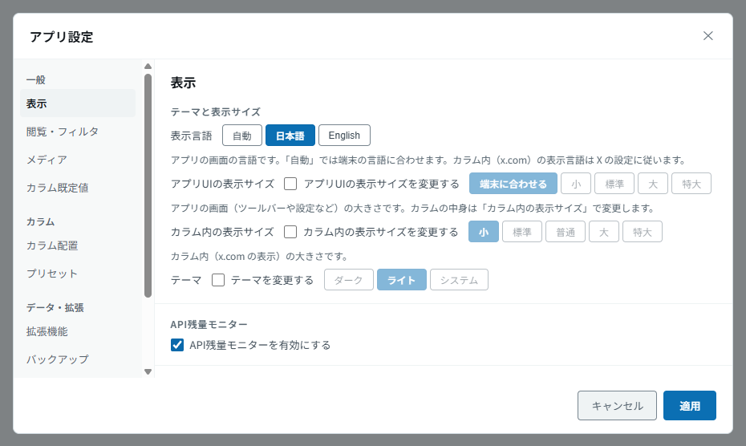
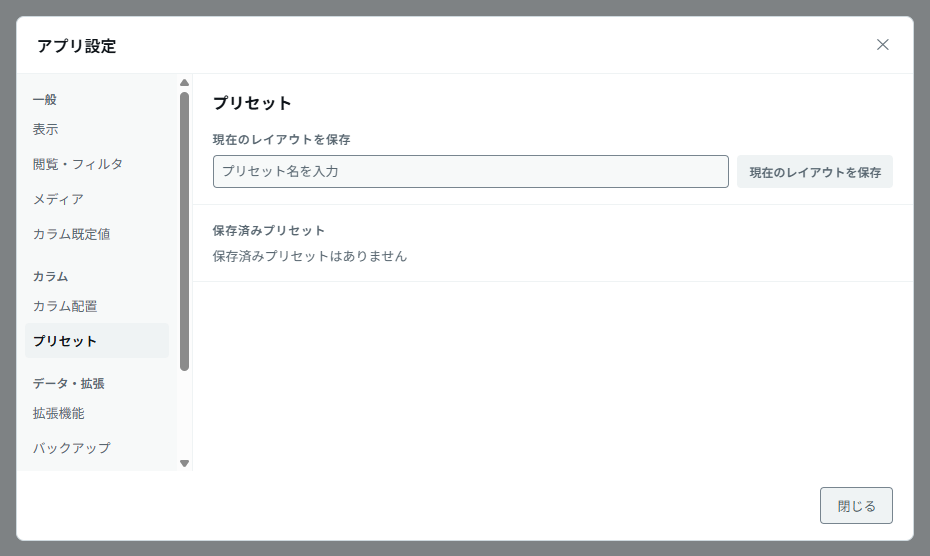
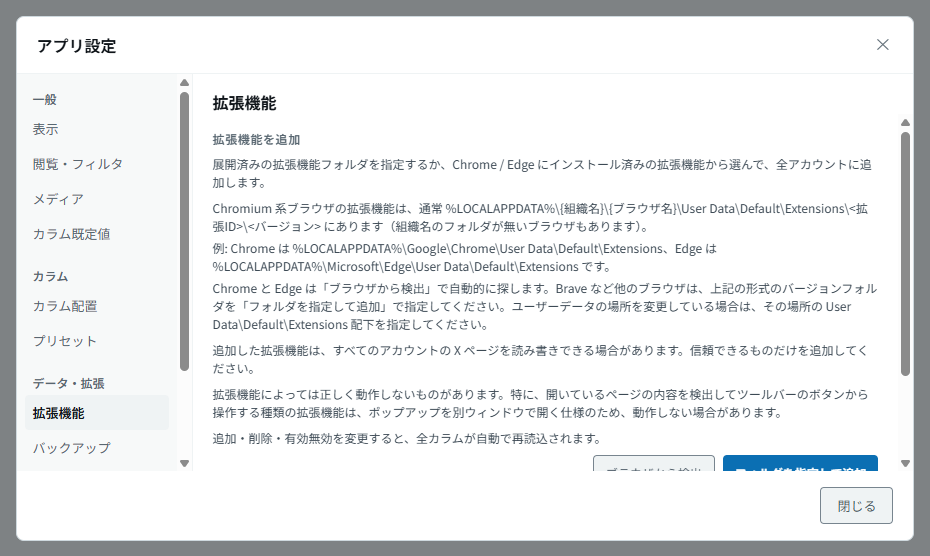
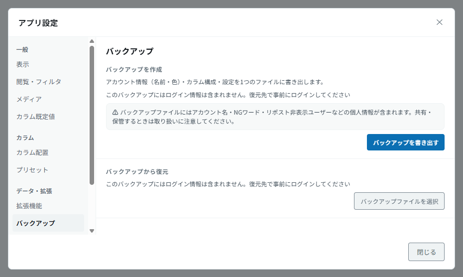

# 設定

## アプリ全体設定

ツールバーの **設定**（歯車アイコン）ボタン（`Ctrl+,`）でアプリ全体の設定を開きます。左側のナビゲーションからカテゴリを選ぶと、そのカテゴリの設定ページに切り替わります（開くたびに先頭の「表示」から始まります）。

| 分類         | カテゴリ           | 内容                                                                            | 対象環境                 |
| ------------ | ------------------ | ------------------------------------------------------------------------------- | ------------------------ |
| 一般         | 表示               | 表示言語・テーマと表示サイズ・API残量モニター                                   | 全環境                   |
| 一般         | 閲覧・フィルタ     | X 公式設定・グローバル NG ワード・リポスト非表示ユーザー・広告                  | 全環境                   |
| 一般         | メディア           | 動画・ポップアップウィンドウ・動画再生（Linux）                                 | 全環境（項目は環境ごと） |
| 一般         | カラム既定値       | 新しく追加するカラムの初期設定と、既存の全カラムへの適用                        | 全環境                   |
| 一般         | Android専用        | ツイート・スワイプ切替・複数カラム表示                                          | Android のみ             |
| カラム       | カラム配置         | カラムの配置・並び順（[グリッドレイアウト](./columns#グリッドレイアウト-応用)） | 全環境                   |
| カラム       | プリセット         | レイアウトの保存と呼び出し                                                      | デスクトップのみ         |
| データ・拡張 | 拡張機能           | Chrome / Edge 拡張機能の追加と管理                                              | Windows のみ             |
| データ・拡張 | バックアップ       | 設定・カラム構成の書き出しと復元                                                | 全環境                   |
| アプリ       | メンテナンス       | WebView の再生成・データフォルダの削除                                          | 全環境                   |
| アプリ       | このアプリについて | 現在のバージョンと更新の確認                                                    | 全環境                   |

環境ごとの機能の違いは [対応環境と機能一覧](./environments) にもまとめています。

_左のナビゲーションでカテゴリを切り替えます。「表示」ではアプリUIの表示サイズ・カラム内の表示サイズ・テーマなどを設定できます。_

### 設定の適用と未適用の印

「表示」「閲覧・フィルタ」「メディア」「カラム既定値」「Android専用」の 5 カテゴリは 1 つの下書きを共有しており、カテゴリをまたいで編集した内容は、下部の **「適用」** を押したときにまとめて保存されます（**「キャンセル」** で破棄して閉じます）。まだ適用していない変更があるカテゴリには、ナビゲーションに印（●）が付きます。値を元に戻すと印は消えます。

NG ワードやリポスト非表示ユーザーに入力エラーがあると適用できず、「閲覧・フィルタ」に切り替わってエラーを表示します。

それ以外のカテゴリ（カラム配置・プリセット・拡張機能・バックアップ・メンテナンス・このアプリについて）は、下部のボタンは **「閉じる」** だけです。カラム配置はページ内の **「適用」**、そのほかは操作した時点で反映されます。

Android では、まずカテゴリの一覧（分類ごとに説明付き）が表示され、カテゴリをタップすると詳細画面に切り替わります。詳細画面では、ヘッダーの戻るボタンまたは端末の戻る操作で一覧に戻れます（編集中の内容は保持されます）。

### 表示

- **表示言語** — アプリの画面の言語です。
- **アプリUIの表示サイズ** — ツールバーや設定画面などアプリ自体の大きさです。既定は「端末に合わせる」（Android は端末のフォントサイズ設定に追従）で、「小／標準／大／特大」から固定することもできます（「アプリUIの表示サイズを変更する」にチェックを入れると選択できます）。カラムの中身の大きさとは別の設定です。
- **カラム内の表示サイズ** — カラム内（x.com の表示）の倍率を「小／標準／普通／大／特大」から選びます（「カラム内の表示サイズを変更する」にチェックを入れると選択できます）。
- **テーマ** — 「ダーク／ライト／システム」から選びます（「テーマを変更する」にチェックを入れると選択できます）。
- **API残量モニター** — ツールバーの API ボタン（API レート制限の表示）を有効にするかどうか。

### 閲覧・フィルタ

- **X公式設定** — **「公式設定を開く」** で X 公式の設定画面をポップアップウィンドウで開きます。開いた画面の **「各カラムに適用」** ボタンで、その設定を他のアカウントのカラムへ適用できます。
- **グローバル NG ワード** — 全カラムに共通で適用する NG ワード（各カラムの NG ワードと併用されます）。`/正規表現/` の形式でも指定できます。
- **リポストを非表示にするユーザー** — 指定したユーザー（1 行 1 ユーザー ID）がリポストした投稿を全カラムで非表示にします（各カラムの個別設定と併用されます）。
- **広告** — 広告を非表示にするかどうか。

### メディア

- **動画** — 動画の自動再生を停止するかどうか。
- **ポップアップウィンドウ**（デスクトップのみ） — Esc キーで閉じるかどうか、画像／動画をそれぞれポップアップウィンドウで開くかどうか。
- **動画再生（Linux）**（Linux のみ） — **「ハードウェアデコードを使う（VA-API）」** の切り替え。AppImage 版では **「H.264 を有効化」** で動画の再生に必要なデコーダを取得できます。どちらも反映には再起動が必要です（「今すぐ再起動」ボタンが表示されます）。

### カラム既定値

新しく追加するカラムの初期値を設定します。見出しはカラム設定と同じ名前（自動更新・表示・画像・画像ブラー・カスタム CSS）です。

- ページ上部の **「既存の全カラムに適用」** ボタンで、編集中の既定値を現在あるすべてのカラムに反映できます（対象はページ上部に説明されています）。

### Android専用

Android でのみ表示されます。「ツイートボタンで X アプリを起動する」「スワイプでカラム切替」「広い画面で複数カラム表示」などの項目があります（[Android での使い方](./android)）。

### メンテナンス

- **WebView** — **「全 WebView を再生成」** で全カラムを順番に作り直します（設定は維持されます。表示が乱れたときの復旧に使えます）。
- **データフォルダの削除** — 削除できなかったデータフォルダが残っている場合のみ表示されます（次回起動時にも自動で削除を試みます）。**「データフォルダの削除を再実行」** で削除をやり直せます。

### このアプリについて

現在のバージョンの確認と **「更新を確認」** ボタン（[アプリの更新](./update)）。確認結果は同じページに表示されます。

## プリセット（応用）

> プリセットはデスクトップ版の機能です。

現在のカラム構成（配置）を名前を付けて保存し、後でまとめて呼び出せます。用途別（仕事用・趣味用など）にレイアウトを切り替えたいときに便利です。

1. アプリ設定（`Ctrl+,`）→ **「プリセット」カテゴリ** を選びます。
2. **「現在のレイアウトを保存」** に名前を入力し、保存ボタンを押します。
3. 保存済みプリセットは一覧に表示され、
   - **「読み込む」** … そのレイアウトに切り替えます。
   - **「削除」** … プリセットを削除します。

_名前を付けて現在のレイアウトを保存し、一覧から「読み込む」「削除」を選べます。_

## 拡張機能（応用）

> 拡張機能の管理は **Windows 版のみ** の機能です。他の OS や Android では「拡張機能」カテゴリは表示されません。

Chrome / Edge の拡張機能（content script でページを書き換えるもの、ポップアップやオプションページを持つものなど）をカラムに読み込めます。追加した拡張機能は **すべてのアカウント** のカラムで動作します。

アプリ設定（`Ctrl+,`）→ **「拡張機能」カテゴリ** を選び、次のどちらかで追加します。

- **「ブラウザから検出」** … パソコンにインストール済みの Chrome / Edge の拡張機能が候補として並びます。候補には由来のブラウザ名（Chrome / Edge）が表示され、同じ拡張機能が両方にある場合は Chrome のものが 1 件だけ表示されます。追加したいものの **「追加」** を押します（追加済みのものには「追加済み」と表示されます）。どちらも見つからないときは「Chrome / Edge が見つかりません」と表示されます。
- **「フォルダを指定して追加」** … 展開済みの拡張機能フォルダ（`manifest.json` があるフォルダ）を選びます。ネットワークフォルダや、`manifest.json` の無いフォルダは追加できません。

追加セクションには、拡張機能の保存先パスの案内も表示されます。Chromium 系ブラウザの拡張機能は、通常 `%LOCALAPPDATA%\{組織名}\{ブラウザ名}\User Data\Default\Extensions\<拡張ID>\<バージョン>` にあります（Chrome は `%LOCALAPPDATA%\Google\Chrome\User Data\Default\Extensions`、Edge は `%LOCALAPPDATA%\Microsoft\Edge\User Data\Default\Extensions`）。Brave など他のブラウザの拡張機能や、ユーザーデータの場所を変更している場合は、この形式のバージョンフォルダを「フォルダを指定して追加」で指定してください。

追加後は、一覧「追加済みの拡張機能」には由来のブラウザ名も表示され、次の操作ができます。

- **有効** … チェックの切り替えで、拡張機能の有効／無効を切り替えます。
- **ポップアップを開く／オプションを開く** … 拡張機能がポップアップやオプションページを持っている場合に表示されます。別ウィンドウで開きます。
- **削除** … 拡張機能を一覧から削除します。

追加・削除・有効／無効を変更すると、**全カラムが自動で再読込** されます。

_「ブラウザから検出」の候補と、追加済みの拡張機能の一覧です。有効の切り替え・ポップアップ／オプションの表示・削除ができます。_

> **ご注意** — 追加した拡張機能は、すべてのアカウントの X のページを読み書きできる場合があります。信頼できるものだけを追加してください。
>
> Chrome 固有の機能（`sidePanel` など）に依存する拡張機能は、追加できても一部の機能が動作しないことがあります。特に、開いているページの内容を検出してツールバーのボタンから操作する種類の拡張機能は、ポップアップを別ウィンドウで開く仕様のため、動作しない場合があります。元のフォルダを移動・削除した拡張機能、Chrome / Edge から削除された拡張機能には「見つかりません」と表示され、無効扱いになります。

## バックアップと復元（応用）

アカウント情報（名前・色）・カラム構成・設定を 1 つのファイルに書き出し、あとから復元できます。機種変更や、設定を作り直したいときに便利です。

> **バックアップにはログイン情報（Cookie）は含まれません。** 復元先では、事前に X にログインしておく必要があります。また、ファイルにはアカウント名・NG ワード・リポスト非表示ユーザーなどの個人情報が含まれるため、共有・保管するときはご注意ください。

### バックアップを作成する

1. アプリ設定（`Ctrl+,`）→ **「バックアップ」カテゴリ** を選びます。
2. **「バックアップを書き出す」** を押し、保存先を選びます（ファイル名の既定は `.mcxbackup.json` です）。

_「バックアップを作成」と「バックアップから復元」が並びます。_

### バックアップから復元する

1. 復元先のアプリで、バックアップ内のアカウントに対応するアカウントを先に追加（ログイン）しておきます。
2. 「バックアップ」カテゴリで **「バックアップファイルを選択」** を押し、ファイルを選びます。
3. **アカウントの紐づけ** — バックアップ内のアカウントごとに、復元先のログイン済みアカウントを選びます。「復元しない」を選んだアカウントのカラムは復元されません。
4. **復元の確認** — 復元されるカラム数とスキップされるカラム数を確認し、**「置き換えて復元」** を押します。

_バックアップ内のアカウントごとに、復元先のアカウントを選びます。_

> 復元すると、現在のカラムと設定（ウィンドウ位置を除く）はバックアップの内容に **置き換わります**。アカウント自体は置き換わりません。復元の直前の設定は自動で退避されます。
